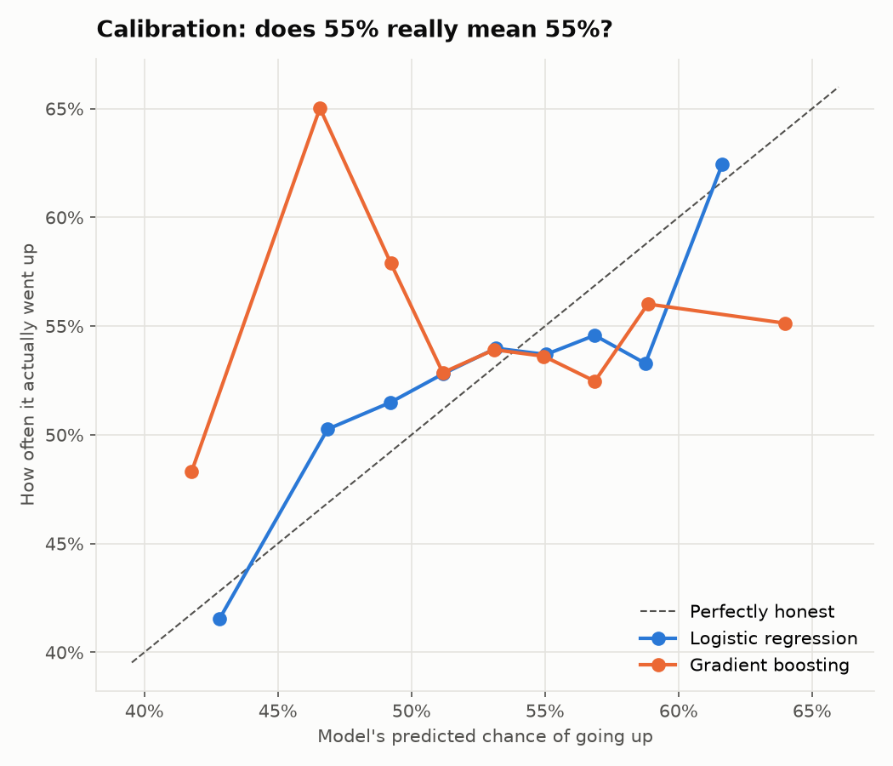
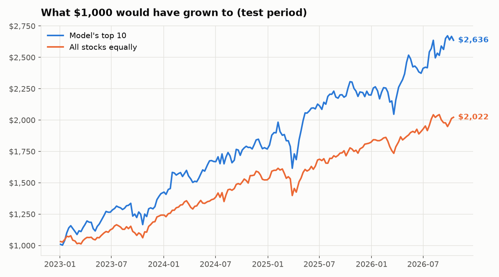
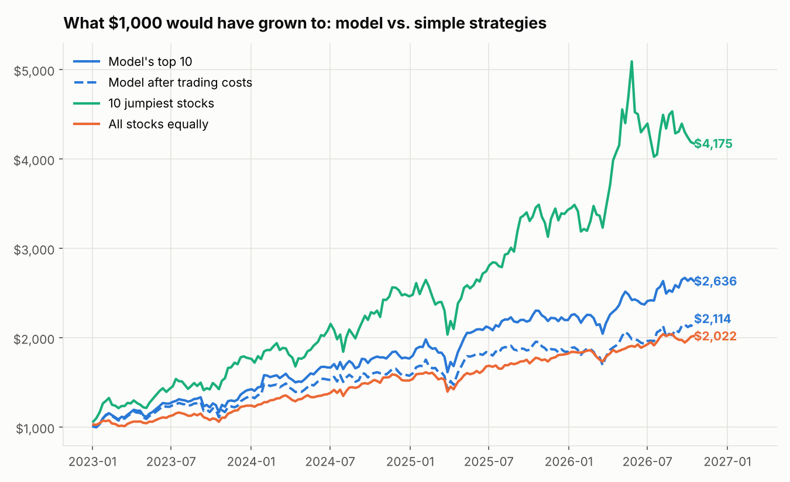
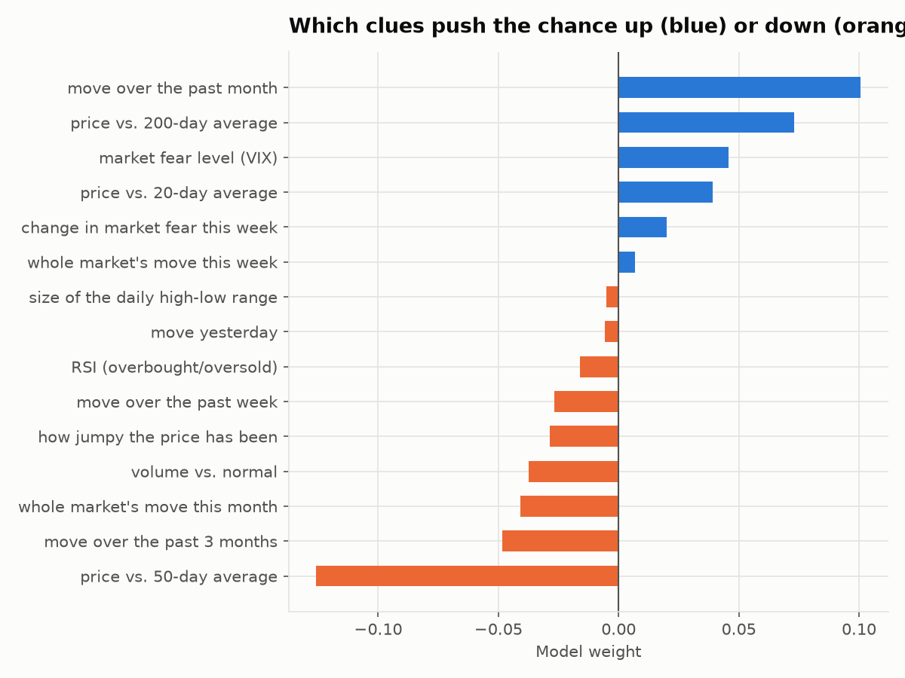

# Stock Probability Model

A machine learning model that looks at the ~100 biggest US stocks and estimates the **% chance each one closes higher 5 trading days from now**, explains which clues drove that number, and shows how accurate it has been on data it never trained on.

Then I tried to break my own results, and they broke.

By Gurutej Bandla.

**Live site:** https://gurutej11-web.github.io/stock-prob-model/ (look up any stock, see its odds, the reasons, and an honest look at how much to trust them). Predictions refresh every weekday after the market closes.

---

## The short version

- The model's percentages are **honest** (when it says 55%, stocks went up about 55% of the time), but it's only **barely better than a coin flip** at telling winners from losers (AUC ≈ 0.51).
- At first, a simple strategy built on it looked great: **+164% vs. +102%** for buying everything (2023 to 2026).
- After stress-testing it, **that edge disappeared.** It came almost entirely from a few stocks (NVDA, PLTR, META...) that I only included because I already knew they'd end up as giant companies. That's **survivorship bias**, and it fully explains the result.

---

## Results

### Calibration: does "55%" really mean 55%?


The logistic regression (blue) roughly follows the diagonal, so its probabilities are trustworthy. The fancier gradient boosting model (orange) is all over the place.

### The strategy test that looked too good


### Stress-testing it (`step4_robustness_checks.py`)


| Check | Result | What it means |
|---|---|---|
| Model's top 10 vs. buy everything | +163.6% vs. +102.2% | Looks great at first |
| Dumbest possible strategy: buy the 10 jumpiest stocks | **+317.5%** | A no-brainer rule crushed the model, so "it beat the market" isn't impressive on this stock list |
| 500 random 10-stock portfolios | Random did as well 6.6% of the time | Suggestive, but not convincing |
| **Remove the 10 biggest winners of 2023–2026** | Model +71.4% vs. buy everything +71.8% | **The whole edge vanishes.** It was survivorship bias |
| Add 0.1% trading costs | +111.4% vs. +102.2% | The model swaps 58% of its picks every week, and costs eat most of the edge |
| Statistical test (t-stat, ~2+ = probably real) | 1.24 before costs, 0.33 after, 0.11 without winners | Could easily be luck |

### Which clues matter most


---

## What I learned

1. **Predicting next week's stock moves is really hard.** With 15 standard trader signals and 12 years of data, the model barely beats a coin flip. That's consistent with how efficient big-company stocks are.
2. **Simpler won.** Logistic regression beat gradient boosting, which overfit the noise.
3. **The model's percentages can be honest even when it has no real edge.** Being calibrated and being useful for profit are different things.
4. **Test results can lie in sneaky ways.** My first strategy result looked like a win, but picking stocks based on what they look like *today* quietly leaked the future into the test. If I hadn't stress-tested it, I would have believed it.
5. **Always compare against dumb baselines.** If "buy the jumpiest stocks" beats your model, your model isn't the reason you're winning.

## Limitations

- The stock list is today's S&P 100, not the list as it was each year (survivorship bias, see above).
- Removing the "10 biggest winners" is a rough fix. The proper way is using historical index membership.
- Trading costs are estimated, and taxes are ignored.
- The S&P 100 list in `tickers.py` changes over time and may be slightly out of date.

## Ideas for next versions
- Use historical S&P 100 membership to remove survivorship bias properly
- Add earnings dates, news sentiment, and sector info
- Predict *risk* (how much a stock will move) instead of direction, which is much more predictable

---

## How it works

**Data:** daily Open, High, Low, Close, Volume for each stock, plus SPY (the whole market) and VIX (the fear index), from Yahoo Finance.

**15 clues per stock per day** (`features.py`):
- Momentum: returns over 1 day, 1 week, 1 month, 3 months
- Trend: price vs. its 20, 50, and 200-day averages
- RSI (overbought/oversold)
- Volatility and daily high-low range
- Volume vs. normal
- Market's weekly and monthly move, VIX level and weekly change

**Label:** did the stock close higher 5 trading days later? (yes/no)

**Models:** logistic regression (simple, explainable) vs. gradient boosting (fancier).

**Honest testing:**
- Trained on 2014–2022, tested on 2023–today, data the model never saw.
- A 5-day "purge" gap between train and test, so no training answers peek into the test period.
- Every feature only uses data available that day (no leakage).
- Compared against a baseline that always guesses the average "up" rate, plus simple rule-based strategies and random portfolios.

---

## Run it yourself

**Setup (one time):**
1. Install Python 3 from https://www.python.org/downloads/ (on Windows, check **"Add python.exe to PATH"** in the installer).
2. Download this repo: green **Code** button → **Download ZIP**, then unzip it. (Or `git clone https://github.com/Gurutej11-web/stock-prob-model.git`)
3. Open a terminal in the project folder and install the libraries:
   ```
   python -m pip install -r requirements.txt
   ```
   (Mac: use `python3` instead of `python`)

**Run, in order:**

| Step | Command | What it does | Time |
|---|---|---|---|
| 1 | `python step1_download_data.py` | Downloads ~12 years of daily prices for all the stocks | ~1 min |
| 2 | `python step2_train_and_test.py` | Builds the clues, trains the model, tests it, makes charts | ~10 sec |
| 3 | `python step3_predict_today.py` | Today's % chance for every stock + why | ~5 sec |
| 4 | `python step4_robustness_checks.py` | Stress-tests the strategy result | ~30 sec |
| 5 | `python step5_export_site_data.py` | Exports everything the website needs to `docs/data.json` | ~10 sec |

**See the website on your own computer:** after step 5, run `python -m http.server 8000 --directory docs` and open http://localhost:8000.

**The website** lives in `docs/` (plain HTML, CSS and JavaScript, with Chart.js for the charts) and is hosted free on GitHub Pages. A GitHub Action (`.github/workflows/update-site.yml`) re-runs steps 1, 2 and 5 every weekday at 5:30pm Central and commits the fresh `docs/data.json`, so the site updates itself.

Look up specific stocks: `python step3_predict_today.py NVDA AAPL TSLA`

Results land in the `output` folder (`results.txt`, `robustness.txt`, the charts, and `predictions_today.csv`).

*This is a learning project, not financial advice.*
